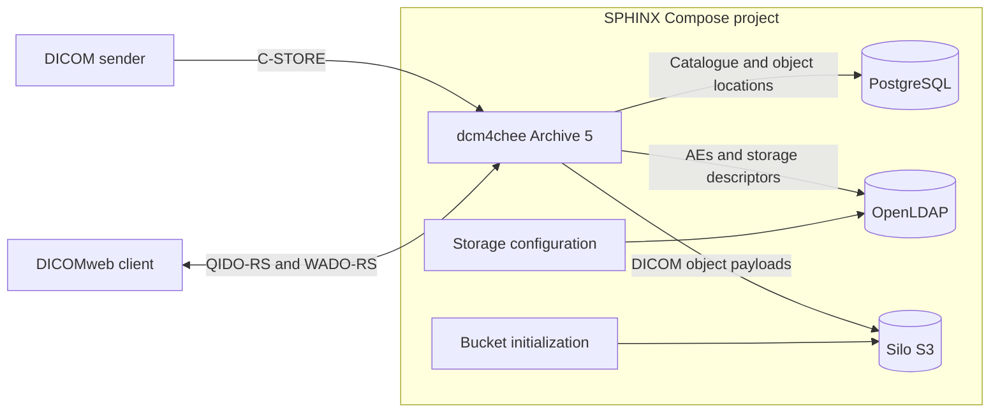

# Architecture and recoverability

## S3 service deployment



Compose runs four persistent services and two initialization jobs. PostgreSQL
stores the catalogue. OpenLDAP supplies the archive configuration. Silo
stores the DICOM objects. dcm4chee exposes DIMSE and DICOMweb on loopback.
The startup sequence creates the private bucket, binds the archive's storage
descriptor to that bucket, and waits for dcm4chee to answer QIDO. Senders
and clients use the archive endpoints directly. [Deployment runbook](deployment.md)

## Filesystem baseline and recovery clients

```text
Synthetic source -- C-STORE --> dcm4chee Archive 5
                                  |-- PostgreSQL catalogue
                                  |-- OpenLDAP device, AEs and storage configuration
                                  `-- named volume at /storage/fs1 (DICOM objects)

dcm4chee -- QIDO-RS / WADO-RS --> local test client -- C-STORE --> independent storescp
```

The Compose project owns separate archive, database, LDAP and WildFly volumes.
The host test client saves a manifest of identifiers and SHA-256 digests before
simulated source loss. The receiver writes its own DICOM files and has no
connection to the archive database, LDAP or storage volumes.

The [S3 test variant](s3.md) and [recovery drill](recovery-drill.md) use
independent Compose projects. They exercise the same archive and storage
components. The Python runner generates synthetic fixtures and verifies
their recovery from those services.

## Catalogue and object storage

PostgreSQL links study and series records to instances and their locations.
A location records a storage ID, storage path, transfer syntax, size and
status. LDAP resolves the storage ID to a descriptor with a URI and any
provider-specific settings. For a filesystem URI, the storage path selects the
file relative to the configured root. For S3, the descriptor identifies the
endpoint and bucket and the location path identifies the object key. An
object key need not encode readable DICOM UIDs. [Location entity in 5.35.2](https://github.com/dcm4che/dcm4chee-arc-light/blob/5.35.2/dcm4chee-arc-entity/src/main/java/org/dcm4chee/arc/entity/Location.java) · [Upstream storage configuration](https://github.com/dcm4che/dcm4chee-arc-light/wiki/Generic-Storage)

If PostgreSQL is lost, normal QIDO and WADO lose the index they use to find
instances and locate the objects. With complete standalone Part 10 objects and
storage access, an operator can list and download objects, read their embedded
identifiers and re-ingest them into an empty archive. Replay creates a new
catalogue from the DICOM contents. Reconciliation would still be needed for
completeness, duplicates, rejections and metadata managed only in the old
catalogue.

Recovery of the original archive would require a coordinated backup of the
PostgreSQL database, LDAP data and configuration (including schema and storage
descriptors), required deployment settings and credentials, and the DICOM
objects. Retain the versions and verify that the database location paths
resolve to the corresponding object versions. The [recovery drill](recovery-drill.md)
quiesces writes and copies those inputs into a separate local project. The
restore relies on the database role and password, LDAP bind credentials,
and the S3 credential and store mapping in the descriptor. WildFly and archive
volumes are initialized fresh in the drill.

In the dependency outage checks, PostgreSQL loss interrupted QIDO and WADO
on the running archive. The already initialized archive answered both
requests with LDAP stopped, but a cold start required LDAP. See the
[recorded outage checks](test-results.md#dependency-outage-checks).
